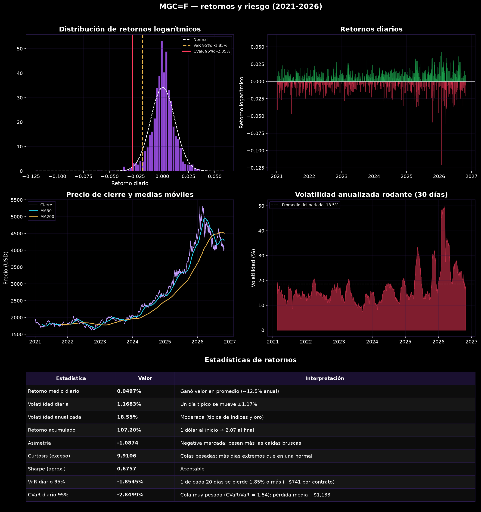
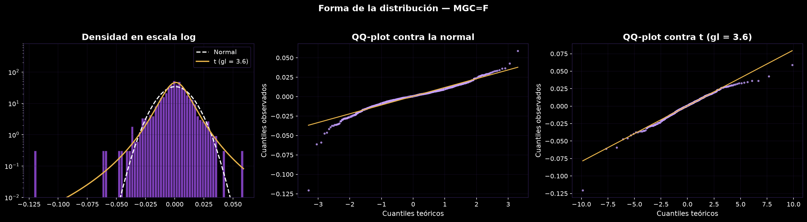
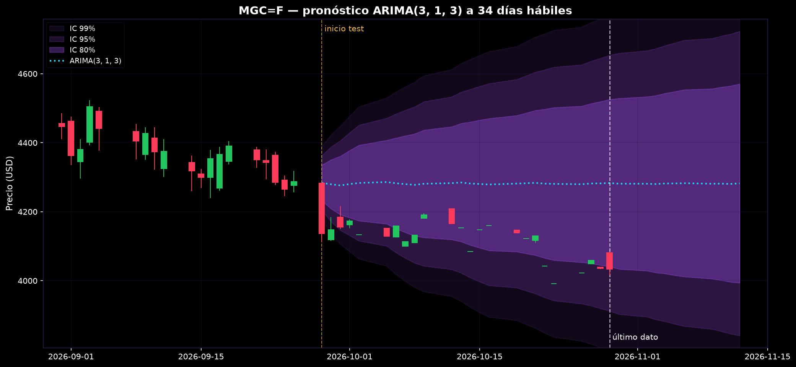
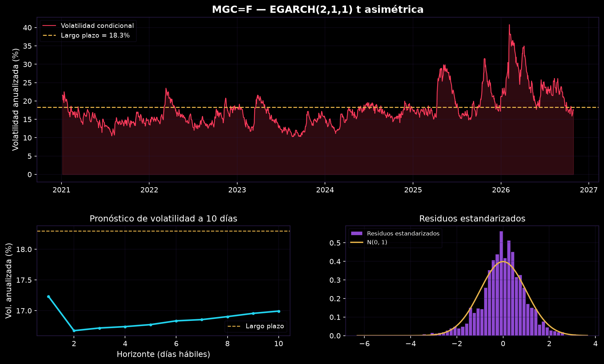

# Series de tiempo en futuros de oro (MGC)

Análisis del micro futuro de oro (MGC) con datos diarios de 2021 a octubre de 2026: riesgo de los retornos, forma de la distribución, estacionariedad, pronóstico del precio con ARIMA y modelado de la volatilidad con la familia GARCH.

La idea del proyecto es saber qué se puede y qué no se puede predecir del oro, y usar lo que sí se puede como apoyo para operar manualmente.

## Estructura

```
├── seriesfin/        # paquete con las funciones (datos, estadísticas, ARIMA, volatilidad, gráficos)
├── analisis.ipynb    # notebook que llama las funciones y comenta los resultados
└── figuras/          # gráficas exportadas desde el notebook
```

## Qué hace

1. Descarga y limpieza de los datos (marca los saltos por cambio de contrato sin borrarlos)
2. Estadísticas de retornos: volatilidad, asimetría, curtosis, VaR y CVaR en dólares por contrato
3. Comparación de la distribución contra una normal y una t de Student
4. Pruebas de estacionariedad (ADF + KPSS) y autocorrelación
5. ARIMA con orden elegido por AIC y evaluación fuera de muestra contra un modelo ingenuo
6. Volatilidad condicional: GARCH(1,1) y búsqueda entre GARCH, GJR-GARCH y EGARCH

## Resultados principales

### Riesgo de los retornos



El precio pasó de 1.947 a 4.032 USD (+107 %) con una volatilidad anual de 18,5 %. El VaR diario al 95 % es -1,85 % (unos 741 USD por contrato) y el CVaR -2,85 %. La asimetría es negativa (-1,09): las caídas bruscas pesan más que las subidas.

### Los retornos no son normales



Jarque-Bera y Shapiro-Wilk rechazan normalidad. La t de Student ajusta mejor (3,6 grados de libertad, AIC más bajo). Hubo 18 días con movimientos mayores a 3σ; la normal esperaba 4 y la t 21,8. Al 99 % el VaR normal (-2,67 %) se queda corto frente al histórico (-3,25 %).

### El precio no se puede pronosticar con ARIMA



El mejor modelo por AIC fue un ARIMA(3,1,3). En el test (28-sep a 29-oct de 2026) la U de Theil quedó en 0,985 a 1 paso y 0,967 a 24 pasos: casi lo mismo que suponer que mañana el precio será igual al de hoy. Además, los residuos no son ruido blanco (Ljung-Box p < 0,01). La línea central se aplana enseguida; lo útil es el ancho del intervalo, que pasa de 159 USD el primer día a 882 USD a 34 días.

### La volatilidad sí se puede pronosticar



Hay efecto ARCH claro (LM = 132, p ≈ 0). El mejor modelo fue un EGARCH(2,1,1) con t asimétrica. La persistencia es 0,98: un shock tarda unos 40 días hábiles en perder la mitad de su efecto. El término de asimetría es positivo, es decir, en el oro las subidas aumentan la volatilidad más que las caídas, algo coherente con su papel de refugio. Hoy la volatilidad está en 17,5 % y el modelo espera que se mantenga cerca de 17 % los próximos 10 días, por debajo de su nivel de largo plazo (18,3 %).

## Conclusiones

- Para medir riesgo en oro no sirve suponer normalidad: conviene el VaR histórico o con t de Student.
- La dirección del precio no es predecible con ARIMA; el modelo no le gana de forma clara al paseo aleatorio.
- Lo aprovechable es la volatilidad: tiene memoria larga y se puede pronosticar. En la práctica sirve para ajustar el tamaño de la posición y la distancia de los stops según el régimen de volatilidad.

## Limitaciones

- Futuros continuos de Yahoo Finance sin ajuste por cambio de contrato.
- El periodo de prueba del ARIMA es corto (24 días) y no hay re-estimación (walk-forward).
- No incluye costos de transacción.
- Es un ejercicio de análisis, no una recomendación de inversión.

## Cómo correrlo

```bash
pip install numpy pandas matplotlib scipy statsmodels arch yfinance
jupyter notebook analisis.ipynb
```

Los parámetros (ticker, fechas, fecha de corte entre entrenamiento y prueba) están en la segunda celda del notebook.
